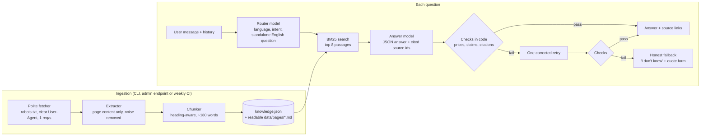

# PlacidWay Website Knowledge Chatbot

A chatbot that answers visitor questions **only** from seven PlacidWay pages (ITC Immunity Therapy
Center in Tijuana: clinic profile, three treatment packages, videos, price list, plus the
alternative-medicine price comparison). Every answer links the page it came from, prices are checked
in code before they reach the user, and when the pages don't say something the bot says so.

- **Live demo:** _added after deployment_
- **Test results for the 8 brief questions:** [docs/test-results.md](docs/test-results.md)
- **Write-up (limitations and next steps):** [WRITEUP.md](WRITEUP.md)

## Quick start

```bash
python -m venv .venv && .venv\Scripts\activate        # macOS/Linux: source .venv/bin/activate
pip install -r requirements-dev.txt
copy .env.example .env                                  # then set LLM_API_KEY (free: aistudio.google.com/apikey)
uvicorn app.main:app --reload                           # open http://127.0.0.1:8000
```

The knowledge snapshot (`data/knowledge.json`) is committed, so the bot works without crawling first.

| Command | What it does |
|---|---|
| `python -m scripts.ingest` | Re-crawl the 7 pages, rebuild the snapshot, print which pages changed |
| `python -m scripts.run_test_questions` | Ask the brief's test questions and write `docs/test-results.md` (`--url` to test a deployment) |
| `python -m pytest` | 42 tests: extraction, chunking, retrieval, price checks, answer pipeline, API |

## How it works



### 1. Collecting the content (`app/ingest/`)
- **Only the 7 URLs from the brief** (`app/sources.py`). The fetcher reads `robots.txt`, identifies itself
  (`PlacidWayAssessmentBot/1.0 ... contact: ...`), waits 1 second between requests and retries
  server errors. If a page can't be downloaded during a refresh, its previous copy is kept.
- **Extraction keeps the page's own content.** The pages are 300-900 KB and full of site-wide widgets.
  The extractor drops scripts, forms, booking and quote widgets, share buttons, accreditation logos,
  footer blocks and cross-promotion of *other* clinics. Without this, "Spinal Fusion Surgery in Saudi
  Arabia, $50,000" from a sidebar could be quoted as if it were an ITC price. Kept: headings, paragraphs,
  lists, and tables as `cell | cell` rows (UI-only columns such as "Chat with Center" removed).
- Things specific to these pages that are handled, each with a test:
  - The comparison page prints each package's **price above its title**. A naive top-to-bottom read gives
    the Croatia program (no price listed) the Bangkok program's $24,000. Each card is read title-first.
  - The package price box has the class `price-social-block-ctm`, so "drop anything with *social* in the
    class" would delete the headline price. Class filters match whole class names.
  - The price list has a broken template sentence ("prices range between `=$priceRange?>`"). Blocks
    with unrendered template code are skipped and counted.
  - Labels repeated on every card (the clinic name under each of 129 videos) are kept once; otherwise
    they drown keyword search.
- **Readable output:** every page is also saved as markdown in [`data/pages/`](data/pages), so you can
  see exactly what the bot knows.

### 2. Chunking (`app/ingest/chunk.py`)
Chunks follow the page's headings and never mix two top-level sections. Small sub-sections (FAQ entries,
video cards) are packed together up to ~180 words, and a table split across chunks repeats its header
row, so `$30,000` always travels with `Program Type | Duration | Total Cost (USD)`. 120 chunks in total.

### 3. Retrieval (`app/knowledge.py`)
BM25 keyword search, written out in about 25 lines with Lucene's IDF.
- **Why not embeddings?** The corpus is tiny (120 chunks) and the questions hinge on exact words: a
  treatment name, "in-patient", "$18,995". BM25 is instant, needs no extra API or vector store, and
  every score can be explained in the review.
- **Lucene IDF** matters: "ITC", "Tijuana" and "cancer" appear in almost every chunk, so they must count
  for little next to "adrenal" or "cost".
- **Multilingual and follow-up questions** are handled before search: a small router model rewrites the
  message into a standalone English question plus keywords ("¿y el tiempo de recuperación?" after an
  adrenal question becomes "recovery time for adrenal cancer treatment").
- Cost questions slightly boost passages that contain prices. Near-identical passages (the same reviews
  appear on three pages) are returned once, unless the user named both pages ("adrenal vs anal").

### 4. Answering and grounding (`app/chat.py`, `app/prompts.py`, `app/guard.py`)
1. **Router** (Gemini 3.1 Flash-Lite): language, intent (`question`, `medical_advice`, `booking`,
   `quote`, `smalltalk`, `out_of_scope`), standalone question, search keywords. Bookings, small talk and
   off-topic messages skip retrieval.
2. **Answer model** (Gemini 3.5 Flash-Lite, temperature 0) sees **only the numbered excerpts**, not the
   chat history, so an earlier answer can't leak unsourced facts into a new one. It returns JSON: answer,
   status (`answered` / `partial` / `not_found` / `declined`), cited source ids, whether the user's own
   figure is supported, a medical flag and a short disclaimer.
3. **Checks in code, not just in the prompt:**
   - Every money amount in the answer must appear in a **source the answer cites** (formats such as
     `18,995`, `18.995`, `18 995` and Arabic-Indic digits are normalised).
   - If the user states a price ("I heard it costs $50"), the answer may not call it correct unless a
     cited source contains it. `$50` does exist on these pages, as a consultation fee, so "it appears
     somewhere" is not enough.
   - Factual answers must cite at least one source.
   - On failure the model gets one corrected retry; if that also fails, the bot gives an honest
     "I couldn't find a reliable answer" and offers the quote form. It never shows an unchecked price.
4. **Honest gaps:** `not_found` answers are logged (`unanswered.jsonl` plus the server log) so PlacidWay
   can see content gaps.

### Tools and models, and why
| Choice | Why |
|---|---|
| Python, FastAPI | Small, typed API; the same code runs locally and as a Vercel function |
| BeautifulSoup + lxml | Precise, testable control over a known HTML template |
| BM25 (own implementation) | See Retrieval above; zero infrastructure |
| Gemini 3.5 Flash-Lite (answers) and 3.1 Flash-Lite (router) | Free tier, multilingual, fast. Free quotas are per model (Flash-Lite about 500 requests/day; Flash only 20/day), so the two steps use different models, with automatic fallback to other Flash-Lite models when one is busy or out of quota |
| OpenAI-compatible client | Swap to Groq, OpenAI, Claude (via a compatible gateway) or a local model by changing three env vars |
| Vanilla HTML/CSS/JS front end | No build step; works on phones; right-to-left text handled with `dir="auto"` |

## Refreshing content when pages change
- **CLI:** `python -m scripts.ingest` re-crawls, compares content hashes and reports `changed / unchanged / failed`.
- **Admin endpoint:** `POST /api/admin/refresh` with header `X-Admin-Token` re-crawls and hot-swaps the
  knowledge base without a restart (enabled when `ADMIN_TOKEN` is set). `GET /api/admin/unanswered`
  lists questions the bot couldn't answer.
- **Scheduled:** `.github/workflows/refresh.yml` runs weekly: re-crawl, run the tests, commit the new
  snapshot if anything changed.

## API
| Method | Path | Purpose |
|---|---|---|
| `POST` | `/api/chat` | `{message, history[], disclaimer_shown}` → answer, status, sources, disclaimer, `offer_quote`, debug (retrieved passages, checks, timing) |
| `POST` | `/api/lead` | Quote request `{name, email, question, consent}` (validated, logged, optional webhook) |
| `GET` | `/api/sources` | The pages the bot knows and when they were fetched |
| `GET` | `/api/health` | Status, model, chunk count, snapshot date |
| `POST` | `/api/admin/refresh` | Re-crawl and hot-swap (token) |
| `GET` | `/api/admin/unanswered` | Content-gap log (token) |

Input is validated (max 800 characters, history capped), and each client is limited to 20 messages
per minute to protect the free API key. No secrets live in the code: everything comes from env vars
(`.env.example`).

## Requirements coverage
| Brief item | Where |
|---|---|
| Content ingestion from the shared URLs only | `app/sources.py`, `app/ingest/fetch.py` (robots.txt, User-Agent, 1 req/s) |
| Knowledge base that finds the right content | `app/ingest/chunk.py`, `app/knowledge.py` |
| Grounded answers citing source URLs | Answer prompt + citation check; links under every answer |
| Honest "I don't know" + free-quote suggestion | `not_found` status, fallback answer, quote button |
| Prices with currency and context | Prompt rule 3 + code price check against cited sources |
| Simple chat UI | `public/` |
| Refresh | CLI, admin endpoint, weekly GitHub Action |
| Live deployment | Vercel (link above) |
| Nice to have: user's language | Router detects language; answers in it (Spanish and Arabic in the test results) |
| Nice to have: follow-ups | Router rewrites follow-ups using history ("What about in Turkey?") |
| Nice to have: medical disclaimer, not on every answer | Shown once per conversation when the topic is medical |
| Nice to have: lead capture | "Request a free quote" form → `/api/lead` |
| Nice to have: logging unanswered questions | `unanswered.jsonl` + server log + admin endpoint |

## Project layout
```
app/
  sources.py        the 7 allowed URLs
  ingest/           fetch.py · extract.py · chunk.py · pipeline.py
  knowledge.py      BM25 index, search, hot-swappable store
  prompts.py        router and answer prompts
  chat.py           route -> retrieve -> answer -> verify
  guard.py          money parsing and checks
  llm.py            OpenAI-compatible client with per-model fallback
  events.py         unanswered-question and lead logs
  main.py           FastAPI app
api/index.py        Vercel entry point
public/             chat page
data/knowledge.json snapshot; data/pages/*.md readable copies
scripts/            ingest.py, run_test_questions.py
tests/              pytest suite
```

## Deploying (Vercel)
`vercel deploy --prod` from the repo root. Set `LLM_API_KEY` (and optionally `ADMIN_TOKEN`,
`LEAD_WEBHOOK_URL`) in the project's environment variables. Static files come from `public/`;
`/api/*` is rewritten to the Python function in `api/index.py`.
